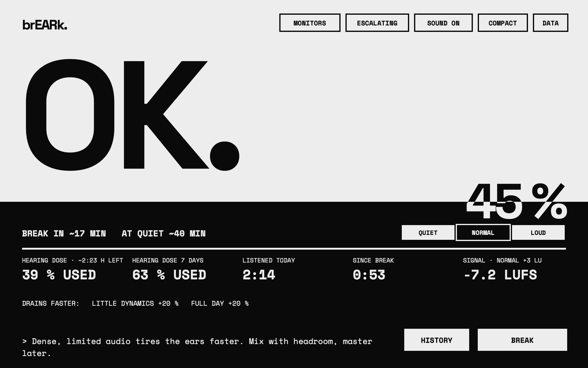
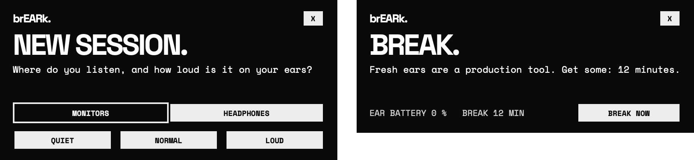
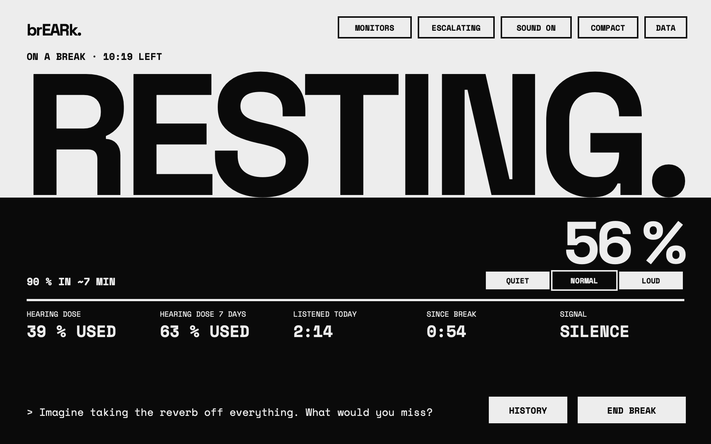
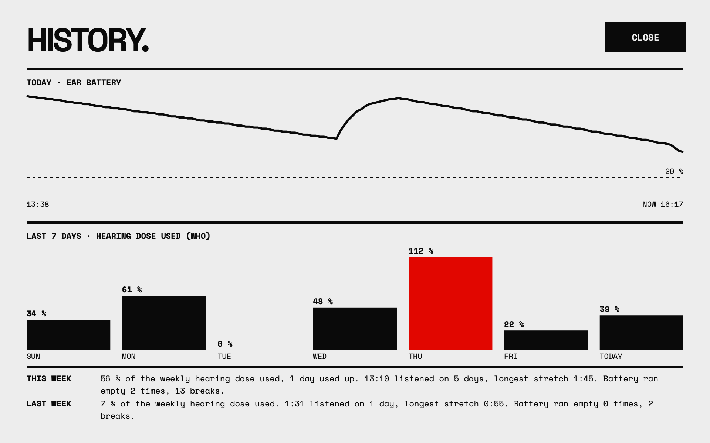
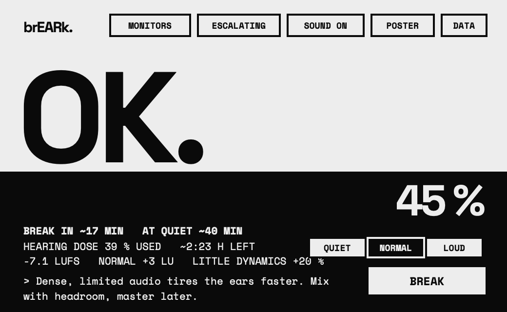

# brEARk.

### A break coach for your ears. For producers who forget to stop.

**[Download brEARk for macOS](https://github.com/kilianjaro/brEARk/releases/latest)** · free and open source · [what's new](CHANGELOG.md)

You sit down to fix one snare. You look up and it's 2 a.m., the mix is harsh, the master is crushed, and your ears are ringing. brEARk sits on your master channel, listens to everything you hear, and tells you when to take a break, before your judgment goes and before your hearing pays for it.

From a test run: brEARk listening to a mastered house loop at about −7 LUFS, after 2 h 14 min of listening today. The day so far was loaded for the test; the level, the drain and the forecasts were measured live by the plugin, and the image is drawn by its own UI code. The battery is draining faster than usual because the master is heavily limited (LITTLE DYNAMICS +20 %) and the day is already well used (FULL DAY +20 %). The music plays 3 LU louder than when NORMAL was set, so the hearing dose runs at about twice the NORMAL pace: ~2:23 h left.

**VST3 · Audio Unit · macOS 11+ · Apple Silicon and Intel · zero latency · bit-identical output · no account, no internet**

---

## Why your ears need a coach

**Ears tire without telling you.** After an hour or two they adapt: the mix seems quieter, so you turn it up; the top end seems dull, so you add more; the limiter seems fine, so you push it harder. The next morning you hear what you did.

**Hearing damage is permanent.** The WHO puts the safe limit at about 80 dB(A) for 40 hours a week, and every 3 dB louder halves the time. A loud session can use up a whole week's share in an afternoon, and nothing in a DAW keeps count.

**Good decisions need fresh ears.** Balance, EQ, loudness and the final master are best decided early, after a break, not at hour four.

brEARk keeps count for you and says it out loud.

---

## Built for hyperfocus

If you lose track of time when the music is working, and many producers with ADHD know that feeling well, a timer you set yourself is easy to wave away. Hyperfocus doesn't check clocks.

brEARk is an outside clock that doesn't get pulled into the flow with you:

- **It watches so you don't have to.** No timers to set and nothing to remember: it starts listening the moment Live plays.
- **Its pop-ups find you.** They float over full-screen Live and on every Space and never steal your keyboard. Messages close after a few seconds, pop-ups with a button stay half a minute, and questions wait for your answer. **SOUND ON / OFF** decides whether they chime.
- **It's honest without nagging.** One big word tells you where you stand: **FRESH.** **OK.** **TIRING.** **BREAK.** **STOP.** In ESCALATING mode, reminders only get firmer if you keep going, and each hint comes at most twice a day.
- **It can hold the line for you.** In HARD mode, brEARk pulls the plug when your ears are spent: the music slows down like a turntable losing power and stops, for at least 5 minutes. It never cuts a recording, and SNOOZE always buys you 10 minutes.
- **It tells you what's left.** "BREAK IN ~17 MIN" and "AT QUIET ~40 MIN" turn an abstract warning into a choice you can act on.

brEARk's pop-ups, drawn by the plugin. Left: the question at the first music of the day, which waits for your answer. Right: a break alert with its BREAK NOW button.

brEARk isn't a treatment for anything. It's the friend who taps you on the shoulder.

---

## The mistakes that creep in over time

brEARk watches for the conditions behind the classic late-session mistakes, and says so while you can still do something about it:

| What happens to tired ears | What brEARk does |
|---|---|
| The mix creeps louder because your ears adapted | Asks **HOW LOUD?** when the music drifts 6 LU or more from where you set your level |
| A bright, edgy mix wears you out (and tired ears ask for even more top end) | **BRIGHT.** when the highs make your ears drain 20 % faster |
| The master gets squashed because loud still sounds "fine" | **SQUASHED.** when peak-to-loudness (PSR) drops to about 8 dB |
| Loop blindness: an hour on the same 4 bars | **LOOP.**, only after a long time: looping is the job, but context matters |
| Big decisions at 2 a.m. | **LATE.** between 23:00 and 05:00, and a faster drain at night |
| Pushing through an empty battery | **BREAK.**, then firmer, or HARD mode's power-down |
| Overdoing the day or the week | **HEARING DOSE** with time left, **DONE.** when it's used up, and a weekly look back |

Read the big word as a schedule: **FRESH.** is the time for the big calls (balance, tone, the master); **TIRING.** is better spent arranging and editing.

---

## A coach, not a nag

brEARk speaks in short lines, at the bottom of its window and in its pop-ups. The tone follows your ears: playful while they're fresh, a calm mentor when they tire, blunt once you ignore a break.

During a break the line changes every minute, and it gives your mind something better to do than checking the mix:

| Every minute, in turn | For example |
|---|---|
| A thought on the track | "Which sound is a placeholder you stopped hearing?" |
| A care tip | "Unclench your jaw. Long sessions pile up tension there." |
| A thought on the craft | "Are you polishing, or avoiding the next hard decision?" |
| An ear fact | "Your ear canal resonates near 3 kHz and boosts it by about 10 dB. That's why harsh mids bite." |

There are about 370 lines, and none comes back before the rest of its kind has been shown, even after you restart Live. You can add your own in a plain text file.

A break in the same test run: the music stopped and BREAK was pressed. A minute later, the coach line at the bottom shows its first thought on the track, picked at random from 58.

---

## How it works

brEARk keeps two meters:

- **Ear battery:** how tired your ears are right now. It drains while you listen (faster when it's loud, bright, squashed, repetitive or late) and refills in silence. A minute of silence starts recovery; 5 minutes counts as a break.
- **Hearing dose:** how much of today's safe sound you've used, after the WHO. A full day at NORMAL is 8 hours; louder uses it faster. It doesn't refill during the day. At 100 % brEARk says **DONE.**

**Your ears set the level; brEARk measures the music.** brEARk can't hear your room or see your volume knob, so it never guesses dB at your ears. Instead you rate it: **QUIET** (you could talk normally), **NORMAL** (you'd raise your voice) or **LOUD** (you'd have to shout), and **MONITORS** or **HEADPHONES**. brEARk asks at the first music of the day (and after 2 hours away) and listens to the music for about two minutes to lock your rating in. From then on it measures how much louder or quieter the music is than when you rated it, and asks again when it drifts. You can change the rating any time with the switch in the window.

| At the level you rated | A day's hearing dose lasts |
|---|---|
| **QUIET** | practically all day |
| **NORMAL** | 8 hours |
| **LOUD** | 2.5 hours |

Music louder than when you rated it uses the dose faster: every 3 LU halves the time.

**You choose how strict it is:**

| | When the battery is empty |
|---|---|
| **GENTLE** | One sound and a pop-up |
| **ESCALATING** | BREAK. again after 10 more minutes of listening, STOP. after 20, then every 15 minutes |
| **HARD** | The plug comes out: a vinyl spin-down, then silence for at least 5 minutes |

HISTORY from the same test run: today's ear battery with one break, the last 7 days of hearing dose (red: one day used it up), and this week compared with last week.

Every pop-up and its trigger is listed in [docs/ALERTS.md](docs/ALERTS.md).

---

## The interface

Built to be read from across the room, in the corner of your eye:

- **One big word** says where your ears stand. Under it, one line says what's happening; above the numbers, one line says how much time is left. Nothing is said twice.
- **The black area is the battery.** It sinks as your ears tire and turns red at 20 %. The whole window turns red when brEARk means it: STOP., UNPLUGGED., DONE. in HARD mode.
- **Two sizes:** POSTER, big enough to read from across the room, and COMPACT for when screen space is tight.
- **Every value and button explains itself** when you hover over it: what it shows, and what it means for you.
- **HISTORY** shows today's battery, the last 7 days and the week; **DATA** shows every raw number.
- Set in Space Grotesk and Space Mono. Paper, ink and one signal red.

COMPACT, from the same test run.

---

## Studio-safe by design

brEARk lives on your master, so it's built to be invisible there:

- **It never touches your audio.** The output is bit-identical to the input, proven by a bit-exact null test, with zero latency and no phase shift. The only exception is HARD mode's power-down, and only when you've asked for it.
- **Exports are sacred.** Bounces and renders are never measured, never alerted, never muted.
- **Practically no CPU.** On the audio thread brEARk only copies samples: about 0.02 % of one core. All analysis runs on a low-priority background thread.
- **Small and steady.** About 2–3 MB of memory (a little more in HARD mode at high sample rates), flat over hours. It's tested with three-hour soak runs and checked for any allocation or lock on the audio thread.
- **Private.** No account, no internet. Your listening history stays in a small file on your Mac.

---

## Install

1. Download **brEARk-1.0.0-macOS.pkg** from the [latest release](https://github.com/kilianjaro/brEARk/releases/latest).
2. Open it and follow the steps. It installs the VST3 and the Audio Unit for all users (`/Library/Audio/Plug-Ins/`), so macOS asks for your password.
3. Open Live. If brEARk doesn't show up under Plug-Ins: Live › Preferences (Settings in Live 12) › Plug-Ins, turn on **Use VST3 Plug-In System Folders** (or **Use Audio Units**), then **Rescan**.

**Requirements:** macOS 11 or later, Apple Silicon or Intel. Made and tested in Ableton Live 11; other VST3 and Audio Unit hosts on macOS should work too, but aren't tested yet. [Tell us](https://github.com/kilianjaro/brEARk/issues) how it goes.

Each release lists the installer's SHA-256 next to it, if you want to check your download (`shasum -a 256 brEARk-1.0.0-macOS.pkg`).

## Get started

1. Put **brEARk** on Live's **master** track (one per set).
2. Press play. After a few seconds, **WELCOME.** asks where you listen and how loud it is. One click each. From then on brEARk asks once a day.
3. Pick **GENTLE**, **ESCALATING** or **HARD**, and **SOUND ON** or **OFF**.
4. Make music. When brEARk says **BREAK.**, take it: as long as it suggests (5 to 25 minutes), in quiet, away from the speakers.

Hover over anything in the window to learn what it shows. **DATA › HELP** brings you back here.

## Uninstall

Delete `brEARk.vst3` from `/Library/Audio/Plug-Ins/VST3` and `brEARk.component` from `/Library/Audio/Plug-Ins/Components` (in the Finder: Go › Go to Folder…). Your listening history and settings are in `~/Library/Application Support/brEARk`; delete that folder too if you want them gone.

---

## FAQ

**Will brEARk change my sound?** No. Its output is bit-identical to its input, with zero latency; an automated null test checks it bit for bit. The only exception is HARD mode's power-down, and only when your battery is empty.

**I have a client in the room, or it's late at night.** Turn **SOUND OFF**: the pop-ups keep coming, silently. Or switch to **GENTLE**. Or switch brEARk off in Live: it freezes until you switch it on again, and HISTORY shows the time as OFF.

**The battery drains faster than I expected.** Check your level rating: if what you hear is NORMAL, say NORMAL. A bright or heavily limited mix, long loops and late hours also drain faster; POSTER's DRAINS FASTER line shows why.

**Does brEARk work in Logic, Bitwig or Reaper?** It passes Apple's and Tracktion's plugin validators as VST3 and Audio Unit, but it's only tested in Ableton Live 11 so far. Reports are welcome.

**Two DAWs open at once?** Each one counts on its own and they share one history file; use brEARk in one at a time.

**Windows or Linux?** Not yet. brEARk's pop-ups and alert sound use macOS.

**Does it send anything anywhere?** No. No account, no analytics, no update check. Everything stays in `~/Library/Application Support/brEARk`.

---

## Under the hood

For the engineers in the room:

| | |
|---|---|
| **Formats** | VST3 and Audio Unit, built with JUCE 8. macOS 11 or later, universal binary (Apple Silicon and Intel). |
| **Audio path** | Pass-through with 0 samples of latency. 32- and 64-bit processing, mono and stereo, 44.1 to 192 kHz. An automated null test hosts the installed VST3 and AU and requires bit-identical output, also when brEARk is switched off and on mid-stream. |
| **Loudness** | ITU-R BS.1770 (LUFS, 400 ms momentary and 3 s short-term), checked with the EBU Tech 3341 test signals. |
| **Hearing dose** | A-weighted level (IEC 61672) from an FFT spectrum, against the WHO / ITU-T H.870 safe-listening limit: 80 dB(A) for 40 hours a week, equal energy, 3 dB exchange rate. Your NORMAL rating is taken as 80 dB(A). |
| **Ear battery** | brEARk's own fatigue model: perceived loudness against your rating (every 5 dB doubles the drain), multiplied by brightness, dynamics (PSR), repetition, time of day and the day's dose, capped at ×1.6. Recovery starts after 60 s of silence, with a 5-minute time constant. |
| **Brightness** | Energy at 2–5 kHz and 8–16 kHz against the 250 Hz–2 kHz body of the mix. |
| **Loops** | Detected on Live's tempo grid: one FFT per 16th note, loops of 1 to 16 bars, robust to small fader and EQ moves. |
| **Threads** | The audio thread only copies samples into a lock-free FIFO: no allocation, no locks, no file access, verified during the soak test by intercepting every allocation and lock. All analysis runs on one shared low-priority worker; the window redraws 4 times a second. |
| **CPU** | Audio thread 0.017 % of one core (Instruments, 48 kHz / 512 samples). All analysis together about 0.1 % of one performance core (benchmark). |
| **Memory** | 1.8 MB at 44.1 or 48 kHz, up to 3.0 MB at 192 kHz, allocated before playback. HARD mode adds a 2-second buffer for the power-down (1 MB at 48 kHz). |
| **Host awareness** | Exports (flagged by the host, or audio faster than real time) are never counted. Switched off in Live: everything freezes and HISTORY shows the time as OFF. A sleeping Mac counts as rest. The first brEARk in Live listens; a second one shows INACTIVE. |
| **Your data** | `~/Library/Application Support/brEARk/`: `state.json` (settings, today and 14 days of history), `coach-memory.json` (which coach lines and hints you've seen) and your own `coach.txt`. brEARk never connects to the internet: it makes no network requests at all, and it doesn't check for updates; new versions are announced on the [releases page](https://github.com/kilianjaro/brEARk/releases). |
| **Testing** | Over 3,400 automated checks (run on every push), the null test, pluginval at strictness 10 (VST3 and AU), auval, and a 3-hour soak test across 8 audio device setups (44.1–192 kHz, 64–2048 samples, 32/64-bit, mono/stereo) with the editor opened 100 times and memory checked every hour. On Apple Silicon and, for Intel, under Rosetta. |

---

## Honest numbers

brEARk is a coach, not a medical device. The hearing dose follows the WHO's safe-listening guidance, with your NORMAL rating taken as the WHO's 80 dB(A); the ear battery is brEARk's own model of listening fatigue, an estimate tuned by ear. Because brEARk can't hear your room, the level on your ears comes from your own rating, and everything brEARk shows about the signal (LUFS, LU, PSR) is measured, not guessed. If your ears ring or feel muffled, stop for the day, and see a hearing professional if it doesn't pass.

---

## Free and open source

brEARk is free software under the [GNU AGPLv3](LICENSE): use it, study it, change it, share it. If you share a changed version, share its source too. It's built with [JUCE](https://juce.com); the fonts are Space Grotesk and Space Mono under the SIL Open Font License ([third-party notices](THIRD_PARTY_NOTICES.md)).

Bugs and ideas: [GitHub Issues](https://github.com/kilianjaro/brEARk/issues). Building from source and the developer tools: [docs/DEVELOPMENT.md](docs/DEVELOPMENT.md). Every alert in detail: [docs/ALERTS.md](docs/ALERTS.md).

**Support brEARk:** if it helps you, you can support its development at [totemphonia.com/info](https://totemphonia.com/info).

brEARk is made by [Totemphonia Studio Berlin](https://totemphonia.com).
